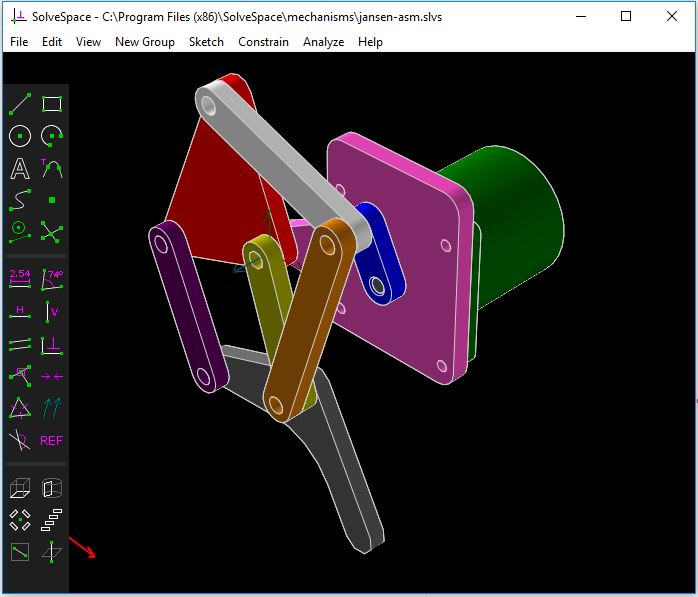
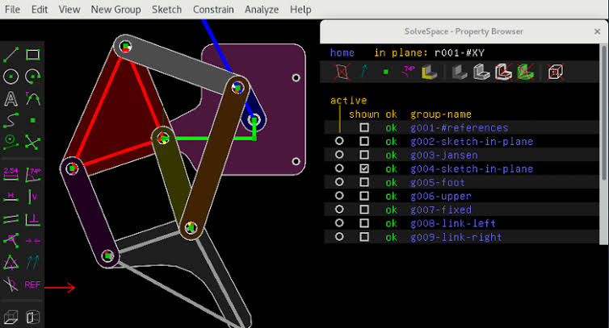
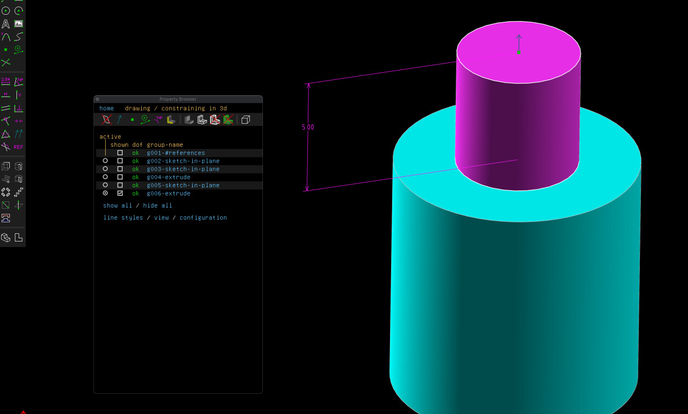

# SolveSpace, from Dimensioned Sketch to Mechanical Part

Design a small mounting plate whose width can change while its holes stay aligned.
SolveSpace 3D lets the geometry express those relationships through constraints, then carries the sketch into solid modeling and export.

## Describe the revision the part must survive

Before drawing, decide what should happen when a dimension changes.
For this exercise, the plate becomes wider while keeping its height, thickness, and hole diameter unchanged.
The holes remain centered vertically and equally spaced from the two ends.

Write down the few values that define the part:

- Plate width: 80 mm.
- Plate height: 30 mm.
- Thickness: 4 mm.
- Hole diameter: 5 mm.
- Hole-center distance from each short edge: 10 mm.

These are illustrative design values, not manufacturing tolerances or a verified mounting specification.
Choose dimensions and clearances appropriate to the real mating hardware.

The useful test is a deliberate width change, such as 80 mm to 100 mm.
The resulting geometry should explain whether the model captures your intent.

[](https://solvespace-3d.github.io/SolveSpace/)

## Constrain relationships before freezing coordinates

### Establish an anchor

Draw the outline in a workplane and give it a clear relationship to the origin.
Without an anchor, a rectangle can retain its shape and dimensions while still translating in the plane.

Use the remaining degrees of freedom to identify what can still move.
For a finished static sketch, remove unintended movement.
For a mechanism, retain only the movement the design is meant to allow.

### Dimension the shape

Use geometric constraints for horizontal edges, vertical edges, alignment, and equality.
Use dimensions for quantities that must carry a numerical value.
A line that merely looks horizontal is not the same as a line constrained to remain horizontal.

Place the two circles, constrain their diameters equally, and locate their centers relative to the plate.
Keep the intended edge offsets and vertical alignment independent of the overall width.



Change the width and check both hole positions.
If the whole sketch moves instead of resizing as intended, revisit its anchor.
If the solver reports conflicting constraints, inspect the most recently added relationship before adding another dimension.

The [official reference](https://solvespace.com/ref.pl) explains constraint selection and workplane behavior.
At the library boundary, [slvs.h](include/slvs.h) declares the geometric solver's C data structures and entry points.

## Give each modeling group a clear job

A closed planar outline can become a solid through an extrusion group.
Keep the thickness as an explicit dimension, then inspect the part from several directions.

For this plate, decide whether the circles belong to the original closed section or to a later subtractive operation.
The first approach creates the profile with holes already present.
The second separates the plate body from the geometry that removes material.

Choose the approach that makes later edits easiest to explain.
Inspect the result after changing width, thickness, and hole diameter one at a time.



A shaded result should still be checked for the intended holes, surfaces, and dimensions.
An unintended open contour can prevent the expected solid from being generated.
Overlapping or duplicate sketch geometry can also make the result harder to interpret.

For readers following the implementation, [Solver_Transforms.txt](developer_docs/Solver_Transforms.txt) describes transformed entities used by modeling groups.
The notes in [IdLists_Entities_and_Remap.txt](developer_docs/IdLists_Entities_and_Remap.txt) explain entity handles and remapping when earlier geometry changes.

Those references help connect group dependencies to the visible behavior of an edited model.
They are developer explanations rather than step-by-step drawing instructions.

## Match the export to the next operation

Retain the native SLVS model as the editable master.
An exported representation serves the next tool and may not retain the constraints that produced it.

| Representation | Information to preserve | Typical next operation | Check after opening |
| --- | --- | --- | --- |
| STL triangle mesh | Approximate surface geometry | Slicing a printable part | Dimensions, hole shape, and mesh quality |
| STEP surfaces | Exact surface representation | Downstream CAD or CAM exchange | Surface completeness and imported units |
| DXF or SVG view | Projected curves and outlines | Drawing or cutting workflow | Plane, scale, and duplicate paths |
| PDF view | Fixed drawing appearance | Review or printing | Page scale and visible details |

Use the separate command-line application when it is included in your installation.
With an existing model named `mounting-plate.slvs`, these native commands request mesh and surface exports:

```bash
solvespace-cli export-mesh --output "%-print.stl" --chord-tol 0.05 mounting-plate.slvs
solvespace-cli export-surfaces --output "%-surfaces.step" mounting-plate.slvs
```

The output pattern replaces `%` with the input model's base name.
For mesh export, chord tolerance is an approximation setting expressed in millimeters.
It is not a promise of printer accuracy or the tolerance of the manufactured part.

The [upstream CLI implementation](https://github.com/solvespace/solvespace/blob/master/src/platform/entrycli.cpp) documents these commands and arguments.
CLI availability varies by package; the graphical application also provides export operations.
Confirm that the model contains the intended solid before interpreting an exported file as a finished part.

For a planar cutting outline, select the intended workplane or projection and review the exported curves in the receiving tool.
A drawing that looks correct at fit-to-window scale can still carry an incorrect scale or unwanted geometry.
Check one known dimension before passing the file into a fabrication workflow.

## Use the solver library for a smaller geometric question

The solvespace cad application and its solver library serve different levels of the workflow.
The library can solve geometric relationships without creating a complete desktop modeling session.

The following original example uses the supplied Python binding's API.
It asks for two points to remain 25 units apart; it intentionally leaves other freedom available.

```python
import slvs

slvs.clear_sketch()
plane = slvs.add_base_2d(1)
first = slvs.add_point_2d(1, 0, 0, plane)
second = slvs.add_point_2d(1, 20, 8, plane)
slvs.distance(1, first, second, 25, plane)
result = slvs.solve_sketch(1, False)
print(result["result"], result["dof"])
```

The points' initial coordinates are starting guesses.
A successful solve with remaining degrees of freedom is consistent with this deliberately incomplete specification.
Check the result flag before reading solved parameters.

The public imports are listed in [__init__.py](python/slvs/__init__.py).
Signatures and result fields are described by [solvespace.pyi](python/slvs/solvespace.pyi).
The examples in [test.py](python/tests/test.py) exercise linkage and other geometric problems, while [__main__.py](python/tests/__main__.py) provides the test runner.

The build metadata in [pyproject.toml](pyproject.toml) identifies the Cython-wrapped solver package.
An installed, compatible compiled binding is required for the example.
The stub file alone does not provide the implementation.

## Check the part where it will be used

A mounting plate should also be reviewed against its mating parts.
Link native files into an assembly and constrain their relative positions.
Keep linked files together in a portable project layout when moving the design to another computer.

Change the source part and verify that the assembly still expresses the intended relationships.
A linked component can retain unwanted translation or rotation even when it appears correctly placed in one view.



For a mechanism, distinguish a permitted motion from a component that is simply unconstrained.
Inspect several positions rather than judging clearance from one pose.
Geometric motion and interference checks do not establish forces, stresses, or service life.

The [assembly tutorial](https://solvespace.com/box.pl) explains linked parts and constraint-based placement.
The available modeling and analysis operations are summarized on the [features page](https://solvespace.com/features.pl).

## Record a view another person can reproduce

A fixed camera direction is useful when reviewing the same revision on different machines.
If the CLI is available, generate a named isometric preview from the existing model:

```bash
solvespace-cli thumbnail --output "%-review.png" --size 900x600 --view isometric mounting-plate.slvs
```

A thumbnail communicates appearance; it does not replace the editable model or the exported geometry.
Keep the model revision with the review image.
If a later image differs, check the revision and viewing conditions before concluding that the geometry changed.

The supplied [CHANGELOG.md](CHANGELOG.md) records release changes, including solver and geometry-kernel fixes.
Revision identification is supported by [GetGitCommitHash.cmake](cmake/GetGitCommitHash.cmake).
For performance investigations, [harness.cpp](bench/harness.cpp) implements the benchmark runner and [CMakeLists.txt](bench/CMakeLists.txt) defines its build target.

## Distinguish the web target from a complete deployment

A search for solvespace web can lead to an experimental browser build.
Check the build's available functions and file-handling behavior before relying on it for an existing desktop project.
Keep a native copy when evaluating another target.

The supplied [Emscripten.cmake](cmake/Platform/Emscripten.cmake) describes a cross-compilation platform.
The JavaScript package metadata is in [package.json](package.json).
Neither file alone constitutes a complete hosted CAD application.

For reproducible source builds, the selected supporting files document several separate concerns:

- Windows cross-compilation targets: [Toolchain-mingw32.cmake](cmake/Toolchain-mingw32.cmake) and [Toolchain-mingw64.cmake](cmake/Toolchain-mingw64.cmake).
- macOS bundle identity and version fields: [MacOSXBundleInfo.plist.in](cmake/MacOSXBundleInfo.plist.in).
- Dependency lookup for rendering and controller integration: [FindCairo.cmake](cmake/FindCairo.cmake) and [FindSpaceWare.cmake](cmake/FindSpaceWare.cmake).
- System-or-vendored dependency selection: [FindVendoredPackage.cmake](cmake/FindVendoredPackage.cmake), with [AddVendoredSubdirectory.cmake](cmake/AddVendoredSubdirectory.cmake) supporting embedded dependencies.

The contribution guide [CONTRIBUTING.md](CONTRIBUTING.md) describes useful information for a reproducible bug report.
Source licensing is recorded in [COPYING.txt](COPYING.txt), and dependency notices appear in [THIRD_PARTIES.txt](THIRD_PARTIES.txt).

This is a selected SolveSpace solver, binding, and build-support collection rather than a complete buildable application checkout.
The mounting plate, its SLVS filename, and the Python example are illustrative; no finished CAD model or generated export is included.

## Related Search Terms

SolveSpace 3D, SolveSpace, solvespace cad, solvespace web, solvespace parametric cad, cad, parametric, 3d, modeling, mechanical-engineering, 3d-printing, step, stl, dxf, python
